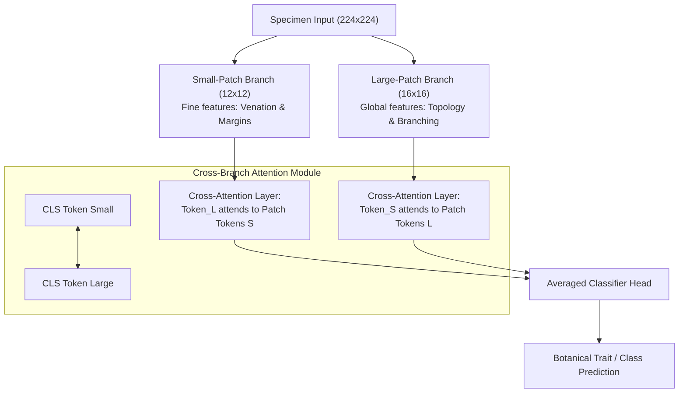

# 🌿 Multi-Scale CrossViT for Botanical Specimen Classification & Interpretability

[](https://pytorch.org/)
[](https://arxiv.org/abs/2103.14808)
[](tests/)
[](LICENSE)

> Research study evaluating **Multi-Scale Vision Transformers (CrossViT)**, **Attention Rollout interpretability**, and **IoU-Regularized Loss** for fine-grained morphological classification on digitized museum herbarium specimen sheets.

---

## 📌 Motivation & Problem Formulation

Digitized botanical specimens stored in natural history museum collections present specific computer vision challenges:
- **Multi-Scale Morphological Features:** Correct botanical identification requires capturing both fine local details (leaf tooth margins, spine structures, venation patterns) and global spatial geometry (stem arrangements, branching angles).
- **Spurious Visual Correlates:** Historical herbarium sheets contain non-botanical artifacts such as archival stamps, accession cards, mounting tape, and handwritten collector notes. Standard Vision Transformers (ViT) frequently attend to these background artifacts rather than actual anatomical plant structures.

This project implements **CrossViT** (Chen et al., ICCV 2021) combined with an **Attention Rollout** mechanism and an **IoU-Regularized objective** to constrain transformer attention onto true plant tissue.



---

## 🔬 Core Contributions & Architecture

1. **Dual-Branch Tokenization (`src/model.py`):**
   - **Small-patch branch** ($12 \times 12$ patches) resolves fine-grained botanical traits.
   - **Large-patch branch** ($16 \times 16$ patches) encodes global specimen context.
   - Cross-attention blocks exchange CLS tokens across branches, avoiding quadratic computational scaling.
2. **Same-Resolution Control Baseline:**
   - Single-scale control variant ($16 \times 16$ across both branches) isolates the mathematical impact of multi-scale tokenization.
3. **Patch-Level Foreground Weighting (`WeightedCrossEntropyLoss`):**
   - Samples are dynamically weighted based on the proportion of true plant pixels inside each patch, reducing background noise.
4. **Attention Rollout & IoU Metric (`src/rollout.py`):**
   - Attention rollout accumulates attention flow across all transformer layers:
     $$\tilde{A} = \prod_{l=1}^{L} \frac{A^{(l)} + I}{\text{rowsum}(A^{(l)} + I)}$$
   - Computes quantile-based ($Q_{0.8}$) Intersection over Union between the attention heatmap and ground-truth botanical masks.
5. **IoU-Regularized Loss:**
   - Explicitly penalizes model attention that leaks outside the plant boundary:
     $$\mathcal{L}_{\text{total}} = \mathcal{L}_{\text{CE}} + \lambda (1 - \text{IoU}(\tilde{A}, M_{\text{plant}}))$$

---

## 📂 Repository Structure

```text
├── src/
│   ├── __init__.py           # Package exports
│   ├── model.py              # CrossViT-Tiny & same-resolution control implementations
│   ├── dataset.py            # HerbariumDataset loader with offline synthetic fallback
│   └── rollout.py            # Attention Rollout, heatmap generation & IoU regularized loss
├── notebooks/
│   └── crossvit_botanical_vision.ipynb  # Documented, end-to-end experiment pipeline
├── tests/
│   └── test_model.py         # Pytest test suite covering models, rollout, and losses
├── data/
│   └── sample/               # Synthetic specimen samples for offline testing (no private data)
├── docs/
│   └── CrossVIT.pdf          # Reference research paper (Chen et al., ICCV 2021)
├── generate_mock_data.py     # CLI utility to generate procedural mock botanical datasets
├── import_public_dataset.py  # Ingestion utility for public datasets (Kaggle, GBIF, PlantVillage)
├── requirements.txt          # Python dependencies
└── README.md
```

---

## 🌿 Dataset Strategies: Synthetic Mocks & Public Benchmarks

Because digitized university or museum herbarium collections may be subject to institutional distribution policies, this repository provides two open, non-proprietary methods for evaluation:

### Option A: Procedural Synthetic Specimen Generation (`generate_mock_data.py`)
```bash
python generate_mock_data.py --samples 32 --output data/sample
```
**How it works:**
- Procedurally synthesizes botanical specimen sheets with realistic paper textures, branching geometry, leaf morphologies, and class traits (e.g. thorn presence for binary classification).
- Generates paired pixel-perfect binary segmentation masks distinguishing plant tissue from archival sheet background.
- Embeds non-botanical artifacts (simulated accession stamps and collector labels) to directly test if attention leaks into background noise.
- Requires **zero external dependencies** or network access; runs in under 2 seconds.

### Option B: Real Open-Access Botanical Data (`import_public_dataset.py`)
To benchmark on real-world museum sheets without proprietary constraints, you can use open-access public data:
1. **Live GBIF Fetcher (Creative Commons / Open Access):**
   ```bash
   python import_public_dataset.py --source gbif --samples 24 --output data/public_sample
   ```
   Queries the [GBIF Open API](https://www.gbif.org/) for digitized museum sheets, downloads high-resolution specimens, and computes automated botanical masks.
2. **Kaggle Herbarium Challenge Ingestion:**
   Download any public competition archive (e.g. [Herbarium 2022 Half-Earth Challenge](https://www.kaggle.com/c/herbarium-2022-fgvc9)) and run:
   ```bash
   python import_public_dataset.py --source folder --input path/to/kaggle_images --output data/kaggle_sample
   ```
   The script automatically derives binary plant masks via adaptive contrast thresholding, excludes corner accession labels, and compiles `metadata.csv`.

### 3. Run Unit Tests
```bash
pytest tests/
```

### 4. Interactive Experimentation
```bash
jupyter lab notebooks/crossvit_botanical_vision.ipynb
```

---

## 📊 Summary of Findings

- **Multi-Scale Advantage:** Dual-branch CrossViT ($12/16$) achieves higher classification accuracy compared to single-scale ViT baselines by preserving both fine texture and broad topology.
- **Attention Regularization:** Constraining cross-attention via the IoU loss term successfully prevents the transformer from latching onto collection stamps and handwritten mounting labels, aligning attention maps with actual botanical structures.

---

## 👤 Author

**Quentin JEAN**  
- AI Engineer & Researcher (CY Tech / Reykjavik University)  
- Focus: Vision Transformers, Agentic AI, Predictive Control & MLOps  
